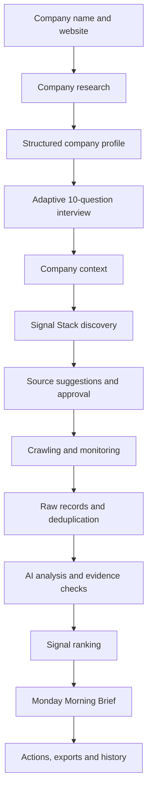

# Signal Stack

### Company Intelligence & Executive Briefing Engine

**Turn scattered company information into evidence-backed business decisions.**

Signal Stack researches a company using its name and website, learns its business context through an adaptive AI interview, discovers relevant information sources, monitors new developments, ranks meaningful signals, and generates a structured **Monday Morning Brief** with traceable evidence.

<p align="center">
  <a href="https://github.com/svb-tech/SignalStack">GitHub Repository</a> ·
  <a href="https://signalstack-l0qw.onrender.com/">Live Application</a> ·
  <a href="https://drive.google.com/drive/folders/1cuC2NQVi5YF-y0kA1ix07KrTTwHDwMwL">Demo Video</a>
</p>

> **Submission note:** Replace `YOUR_RENDER_DEPLOYMENT_URL` and `YOUR_DEMO_VIDEO_URL` above with the actual public URLs before submitting. The GitHub repository is the primary submission link. Keep the repository public so evaluators can access the source code and documentation.

---

## Table of Contents

- [Overview](#overview)
- [Core Capabilities](#core-capabilities)
- [How It Works](#how-it-works)
- [Technology Stack](#technology-stack)
- [Architecture](#architecture)
- [Project Structure](#project-structure)
- [Getting Started](#getting-started)
- [Environment Configuration](#environment-configuration)
- [Running the Application](#running-the-application)
- [Demonstration Workflow](#demonstration-workflow)
- [Additional Company Stress Test](#additional-company-stress-test)
- [Automation](#automation)
- [Testing and Evidence](#testing-and-evidence)
- [Deployment](#deployment)
- [Security and Responsible Crawling](#security-and-responsible-crawling)
- [Known Limitations](#known-limitations)
- [Documentation](#documentation)
- [Cost Statement](#cost-statement)

---

## Overview

Business intelligence is often scattered across company websites, competitor announcements, customer discussions, industry publications, regulatory updates, and internal documents. Reviewing these sources manually takes time and makes it difficult to identify what has changed and what deserves attention.

Signal Stack provides a repeatable workflow for this problem:

1. Add a company and its website.
2. Research the company and build a structured profile.
3. Conduct a 10-question adaptive AI interview to understand business priorities.
4. Build a company-specific Signal Stack across four intelligence categories.
5. Discover, review, and approve relevant sources.
6. Crawl and monitor approved sources for new information and changes.
7. Analyse, verify, classify, and rank collected signals.
8. Generate an evidence-backed Monday Morning Brief with recommended actions.

The system is designed to distinguish **collected evidence** from **AI-generated interpretation**. It does not intentionally fill missing evidence with invented records; when information is unavailable, the application should expose that limitation.

## Core Capabilities

### 1. Company research and profile

- Start with a company name and website.
- Research publicly accessible company pages and relevant search results.
- Build a structured company profile.
- Separate quote-supported facts from assumptions.
- Allow the profile to be reviewed and edited.

### 2. Adaptive AI interview

- Ask 10 main questions, one at a time.
- Use company research, earlier answers, and profile context to shape subsequent questions.
- Ask limited follow-up questions when an answer needs clarification.
- Allow confidential questions to be skipped.
- Update the structured company profile from the interview.

### 3. Four-part Signal Stack

| Category | What it monitors |
|---|---|
| **Customers** | Customer needs, complaints, unmet expectations, alternatives, and customer language |
| **Competitors** | Competitor positioning, products, pricing, announcements, hiring, partnerships, and reviews |
| **Market** | Regulatory, industry, economic, geographic, and technology developments |
| **Internal** | Patterns and risks found in uploaded CSV, TSV, Excel, PDF, and text documents |

### 4. Source discovery and management

- Discover company-specific sources based on the profile and interview.
- Propose competitors using search-grounded discovery rather than a fixed competitor list.
- Generate a reason explaining why a source may be relevant.
- Probe candidate sources and record their status.
- Review and approve suggested sources, or add sources manually.
- Track source health and crawl history.

### 5. Crawling and monitoring

- Support RSS/Atom feeds, webpages, listings, Google News RSS, web search, Hacker News, StackExchange, and optional Reddit API collection.
- Detect page changes using content hashes and text differences.
- Discover new article links from supported listing pages.
- Normalize URLs and deduplicate collected records.
- Retain source and crawl history.
- Respect robots.txt, crawl delays, request timeouts, and host-level rate limits.

### 6. AI analysis and signal ranking

Collected records are analysed for:

- What happened and when (when a date is available).
- The affected business area and relevant competitor.
- Opportunity, threat, or neutral classification.
- Urgency, relevance, and impact.
- Verbatim supporting evidence.
- Why the development may matter and possible next actions.

The system keeps source reliability, evidence strength, and strategic relevance as separate measures. The ranking model combines relevance, impact, urgency, credibility, recency, and novelty. A rank explanation is stored to make prioritisation easier to understand.

### 7. Monday Morning Brief

The generated brief is organised into ten sections:

1. Executive Summary
2. Customer Signals
3. Competitor Intelligence
4. Market Intelligence
5. Internal Business Intelligence
6. Opportunities Identified
7. Risks and Threats
8. Recommended Actions for This Week
9. What We Should Watch
10. Source Appendix

The brief connects findings to collected evidence and source links. Verified facts and interpretation are displayed separately. Reports can be exported as Markdown or HTML, and action items can be tracked.

### 8. Internal business intelligence

Upload supported internal files such as CSV, TSV, Excel, PDF, or text. The system extracts useful information and looks for patterns such as recurring objections, lost-deal reasons, customer requests, and business risks. Findings are only as representative as the uploaded data; if no internal documents are uploaded, the internal section is reported as empty rather than fabricated.

### 9. Jobs, audits, and history

- Weekly brief scheduling.
- Configurable periodic source monitoring.
- Monthly source-health audits.
- Manual job triggers from the application.
- Persistent job execution history, including failures and partial runs.
- Source recommendations that can be reviewed and applied or dismissed.

---

## How It Works



### Evidence-first analysis

The language model is used to structure and interpret collected information, not treated as the source of truth. The backend validates evidence snippets against collected text, checks whether cited evidence exists, and grounds brief facts in stored signals. Interpretations and recommendations remain separate from verified facts.

---

## Technology Stack

| Layer | Technologies | Purpose |
|---|---|---|
| Frontend | React 18, Vite, Tailwind CSS, Recharts | Application UI, dashboards, charts, and workflows |
| Backend | Node.js, Express | REST API and application services |
| Database | MongoDB, Mongoose | Company profiles, sources, collected records, signals, briefs, jobs, and audit history |
| AI | Groq API, Zod | LLM-powered research/interview/analysis and structured output validation |
| Web collection | Fetch, Cheerio, robots-parser | Robots-aware page fetching and HTML parsing |
| Feed parsing | fast-xml-parser | RSS and Atom parsing |
| Internal files | Multer, PapaParse, SheetJS, pdf-parse | Upload and parse supported internal documents |
| Scheduling | node-cron | Weekly briefs, periodic monitoring, and monthly audits |
| Email (optional) | Nodemailer | SMTP-based email delivery when configured |

The application uses a modular Node/Express backend and a React single-page frontend. MongoDB persists application data and job history. Redis/BullMQ is not required by this implementation.

## Architecture

```text
React Single-Page Application
          |
          | REST API
          v
     Express Server
          |
          +---- Authentication and authorization
          +---- Company research and adaptive interview
          +---- Signal Stack and source discovery
          +---- Source collectors and crawler
          +---- Monitoring and change detection
          +---- AI analysis and ranking
          +---- Monday Brief generation and export
          +---- Jobs, scheduling, and source audits
          |
          v
       MongoDB

External services (optional/configurable): Groq, Tavily,
Google News RSS, Hacker News, StackExchange, Reddit API, SMTP
```

Important data entities include Company, Source, RawItem, Signal, CrawlLog, Competitor, Brief, Action, JobRun, AuditReport, InternalDoc, and StackChange.

---

## Project Structure

```text
SignalStack/
├── client/
│   ├── src/
│   │   ├── components/       # Shared UI components
│   │   ├── pages/            # Setup, Dashboard, Profile, Interview,
│   │   │                     # Stack, Sources, Feed, Briefs,
│   │   │                     # Operations, Settings, Login
│   │   ├── api.js            # Frontend API integration
│   │   └── App.jsx
│   └── package.json
├── server/
│   ├── src/
│   │   ├── models/           # MongoDB models
│   │   ├── routes/           # REST API routes
│   │   ├── services/         # Research, interview, stack, crawler,
│   │   │                     # collectors, monitor, analysis,
│   │   │                     # ranking, brief, audit, scheduler
│   │   ├── auth.js
│   │   ├── config.js
│   │   └── index.js
│   ├── scripts/              # Demo and evidence-generation scripts
│   └── test/                 # Automated tests
├── docs/
│   ├── TECHNICAL.md
│   ├── COST_STATEMENT.md
│   ├── REQUIREMENTS_MATRIX.md
│   └── SUBMISSION_CHECKLIST.md
├── Dockerfile
├── docker-compose.yml
├── render.yaml
├── package.json
└── README.md
```

---

## Getting Started

### Prerequisites

- Node.js **18.18 or newer**.
- npm.
- MongoDB running locally, through Docker, or through MongoDB Atlas.
- A Groq API key for AI-powered workflows.

### 1. Clone the repository

```bash
git clone https://github.com/svb-tech/SignalStack.git
cd SignalStack
```

### 2. Install dependencies

From the repository root:

```bash
npm run install:all
```

### 3. Configure environment variables

Create a file named `server/.env` and add the configuration described below. At minimum, set `MONGODB_URI`, `GROQ_API_KEY`, and a strong `JWT_SECRET`.

### 4. Build the frontend

```bash
npm run build
```

### 5. Start the application

```bash
npm start
```

Open [http://localhost:5000](http://localhost:5000). The Express server serves the built React application and the `/api` endpoints from the same origin.

---

## Environment Configuration

Create `server/.env`:

```env
# Runtime
NODE_ENV=development
PORT=5000

# Database
MONGODB_URI=mongodb://127.0.0.1:27017/signalstack

# Authentication (use a long random value; at least 32 characters in production)
JWT_SECRET=replace_with_a_long_random_secret_at_least_32_characters
JWT_EXPIRES_DAYS=7
ALLOW_REGISTRATION=true

# AI (required for AI-powered workflows)
GROQ_API_KEY=your_groq_api_key
GROQ_MODEL=openai/gpt-oss-20b
GROQ_RPM=10

# Optional search and discovery integrations
TAVILY_API_KEY=
REDDIT_CLIENT_ID=
NEWS_REGION=en-US:US

# Crawler identity and politeness
CRAWLER_USER_AGENT=SignalStackBot/1.0 (+https://your-domain.example; contact: your-email@example.com)
CRAWL_HOST_DELAY_MS=2000

# Optional SMTP email delivery
SMTP_HOST=
SMTP_PORT=587
SMTP_USER=
SMTP_PASS=
SMTP_FROM=
```

**Configuration notes:**

- Never commit `server/.env` or expose API keys, database credentials, or JWT secrets.
- In production, `JWT_SECRET` must be at least 32 characters.
- `TAVILY_API_KEY` is optional. Without it, the application attempts a robots-checked DuckDuckGo HTML search fallback; this fallback may be blocked or return no results.
- `REDDIT_CLIENT_ID` is optional and is used for the official Reddit API integration. Reddit pages should not be crawled directly where robots.txt disallows it.
- SMTP variables are only needed if email delivery is configured.
- Update the crawler User-Agent with a real project URL and contact address before production use.

---

## Running the Application

### Development mode

Run the backend and frontend in separate terminals from the repository root.

Terminal 1:

```bash
npm run dev:server
```

Terminal 2:

```bash
npm run dev:client
```

The Vite development server runs on port `5173` and proxies `/api` requests to the backend.

### Run automated tests

```bash
npm test
```

### Run the interactive demo script

```bash
npm run demo -- "MeetUniversity" https://www.meetuniversity.com
```

The demo script can also accept an answers JSON file for a company run. See `server/scripts/` and the demo template included in the repository.

### Generate evidence and export briefs

```bash
npm run evidence
```

This script generates evidence/count output and exports available company briefs into `reports/`. Commit generated reports only after reviewing them and confirming that they contain real collected evidence.

---

## Demonstration Workflow

Use the following workflow for the primary MeetUniversity demonstration:

1. Sign up or log in to the application.
2. Add **MeetUniversity** with `https://www.meetuniversity.com`.
3. Review the generated company profile, including facts and assumptions.
4. Complete the adaptive AI interview. Answer based on the available company context; skip confidential questions where appropriate.
5. Open **Signal Stack** and build the Customers, Competitors, Market, and Internal categories.
6. Open **Source Manager**, review suggested sources, and approve relevant sources.
7. Run source monitoring and inspect the collected records in the intelligence feed.
8. Review evidence, classifications, ranking factors, and source links.
9. Generate and inspect the Monday Morning Brief.
10. Open **Jobs & Audits** and run the monthly source audit.
11. Export the brief as Markdown or HTML.

The assignment asks for at least 20 approved MeetUniversity sources, 5–10 competitor profiles, and 30 or more collected records across the demonstrations. These are runtime evidence targets, not hard-coded sample data. If a source is inaccessible or a target is not reached, report that honestly rather than creating fabricated records.

---

## Additional Company Stress Test

The assignment also asks for two additional companies from different industries. The following are suggested demo configurations; they are not preloaded data and must be run and verified in the application.

| Company | Website | Industry | Example competitor landscape |
|---|---|---|---|
| Zerodha | [https://zerodha.com](https://zerodha.com) | Financial technology / brokerage | Groww, Upstox, Angel One, ICICI Direct |
| Zomato | [https://www.zomato.com](https://www.zomato.com) | Food delivery / consumer technology | Swiggy, magicpin, EatSure |

For each company:

1. Add the company and complete its company-specific interview.
2. Build its Signal Stack and review discovered sources and competitors.
3. Approve relevant sources and run monitoring.
4. Generate a brief and inspect the evidence appendix.
5. Compare the interview questions, source choices, competitors, and signals with MeetUniversity.

To demonstrate context adaptation, edit one company's business profile or growth priorities, select **Reassess Signal Stack**, and show the **What changed** view. This should explain which sources were retained or deprecated and why.

**Crawler note:** A website opening in a normal browser does not guarantee that automated requests are permitted. A source may return 403/429, block bots, or disallow crawling. Use approved public sources and the source manager's status/reason rather than bypassing restrictions.

---

## Automation

Signal Stack supports the following scheduled and manual workflows:

| Workflow | Purpose |
|---|---|
| Weekly brief | Collect updates, analyse and rank signals, then save a new brief |
| Source monitoring | Periodically check approved sources for new content and changes (configurable interval) |
| Monthly source audit | Review dead links, duplicates, inactive or low-yield sources, declining relevance, and potential new sources |
| Manual runs | Trigger monitoring, brief generation, and audits from the application |

Schedules use the company's configured timezone; the default is `Asia/Kolkata`. Job runs are persisted in MongoDB, including success, partial, and failed statuses. The scheduler can perform a catch-up weekly brief after server downtime when its configured conditions are met.

---

## Testing and Evidence

Run the automated test suite:

```bash
npm test
```

The repository's tests cover areas including:

- Password/JWT handling.
- Indian Standard Time helpers.
- robots.txt enforcement.
- RSS/Atom parsing.
- Page change detection and listing crawl behaviour.
- Ranking behaviour.
- Evidence-quote verification.
- URL normalization and SSRF protection.
- Company profile merging.

For submission evidence, include real screenshots or recordings of:

- Company setup and profile.
- Adaptive interview.
- Signal Stack categories.
- Source Manager with source statuses.
- Intelligence feed with evidence.
- Monday Morning Brief and source appendix.
- Jobs and audit history.
- The additional company stress tests and a context reassessment.

Do not claim a test, company run, source count, or report is complete unless you have actually executed it and retained the corresponding evidence.

---

## Deployment

The repository includes a `Dockerfile`, `docker-compose.yml`, and `render.yaml`. The application is designed to run as a **single Node/Express web service**: the server exposes the API and serves the built React frontend from `client/dist`.

### Render configuration

For a single Render Web Service, use:

| Setting | Value |
|---|---|
| Root Directory | Repository root (`.`) |
| Build Command | `npm run install:all && npm run build` |
| Start Command | `npm start` |

Set the required environment variables in the Render dashboard:

- `NODE_ENV=production`
- `MONGODB_URI` — MongoDB Atlas or another reachable MongoDB connection string
- `JWT_SECRET` — strong random secret of at least 32 characters
- `GROQ_API_KEY` — Groq API key
- Optional integration variables as needed

Render provides the `PORT` environment variable to the service. Do not hard-code a production port. After deployment, open the Render URL and verify the UI, login, `/api/health`, company creation, and one complete research-to-brief workflow.

**Hosting limitation:** Free web services may sleep when idle. Because the scheduler runs inside the web process, scheduled jobs cannot execute while that process is stopped or asleep. The application has catch-up behaviour, but that is not a guarantee of exact-time execution on a sleeping free service. Uploaded files stored on an ephemeral host filesystem should not be treated as durable storage.

### Docker

Create `server/.env` first, then run from the repository root:

```bash
docker compose up --build
```

---

## Security and Responsible Crawling

- Passwords are hashed using `scrypt`.
- Authentication uses signed HS256 JWT bearer tokens.
- Company-scoped resources are checked against the authenticated user.
- Registration can be disabled with `ALLOW_REGISTRATION=false` after initial account setup.
- Secrets belong in environment variables, not source control.
- User-supplied URLs are checked to reduce server-side request forgery (SSRF) risk.
- The crawler observes robots.txt rules, host delays, request timeouts, and response-size limits.
- The crawler does not bypass authentication, login walls, or access restrictions.
- Use only data you are authorised to process. Do not upload confidential internal material to third-party AI services unless you have permission and have reviewed the provider's data terms.

---

## Known Limitations

- AI workflows depend on external model availability, rate limits, and free-tier quotas. Large company runs may need retries or smaller workloads.
- Tavily is optional. The DuckDuckGo fallback is best-effort and may be blocked or return no results.
- Google News RSS items may contain headline and snippet information only; they can have lower evidence strength than full-text sources.
- JavaScript-rendered pages, bot-protected sites, and pages that disallow crawling may yield little or no content.
- Dynamic webpages can create noisy change detection.
- Source coverage and brief quality depend on the approved sources and the information actually collected.
- Internal Business Intelligence remains empty until relevant internal documents are uploaded and processed.
- A free hosting service that sleeps cannot guarantee exact-time scheduled execution.

All findings should be reviewed against their linked sources before business decisions are made.

---

## Documentation

| Document | Description |
|---|---|
| [`docs/TECHNICAL.md`](docs/TECHNICAL.md) | Detailed technical architecture and implementation |
| [`docs/COST_STATEMENT.md`](docs/COST_STATEMENT.md) | Free/open-source components, external service limits, and crawler etiquette |
| [`docs/REQUIREMENTS_MATRIX.md`](docs/REQUIREMENTS_MATRIX.md) | Assignment requirements mapped to implementation areas |
| [`docs/SUBMISSION_CHECKLIST.md`](docs/SUBMISSION_CHECKLIST.md) | Final execution and submission checklist |

### Submission resources

- **Public repository:** https://github.com/svb-tech/SignalStack
- **Live application:** Add the actual Render URL above.
- **Demo recording:** Add a viewable Google Drive or video URL above.
- **Sample reports:** Add generated and reviewed reports under `reports/` before submission.
- **Technical documentation PDF:** Add the final PDF under `docs/` if the submission portal requires a PDF artifact.

---

## Cost Statement

The project is designed around open-source software and free tiers. Core application libraries are open source. MongoDB can run locally, in Docker, or on an eligible free database tier. Groq is used through its free tier; Tavily and Reddit API integrations are optional. Google News RSS, Hacker News Algolia, and StackExchange APIs are used where appropriate.

Free-tier quotas, policies, and availability can change. A free plan does not imply unlimited usage or guaranteed uptime. See [`docs/COST_STATEMENT.md`](docs/COST_STATEMENT.md) for the component-level breakdown and limitations.

---

## Assignment

Built as a submission for **EDXSO AI Engineer Intern — Assignment 1: Signal Stack**.

**Repository:** [github.com/svb-tech/SignalStack](https://github.com/svb-tech/SignalStack)
